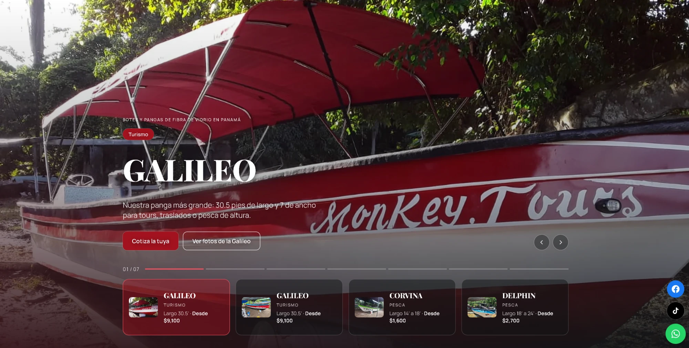
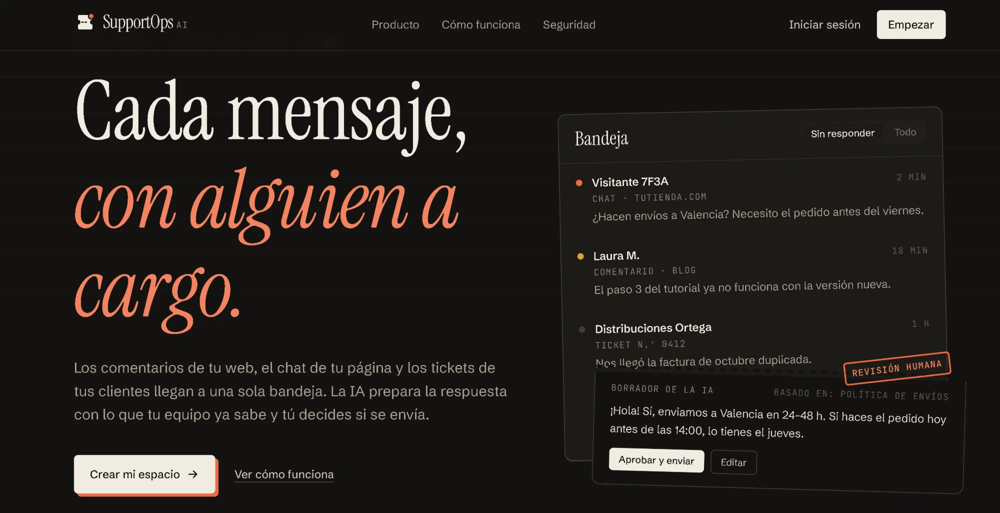

# ⛵ Portafolio de Proyectos — Jose

### 👉 [**Ver portafolio en vivo**](https://portafolio-ten-omega-56.vercel.app/)

Mi portafolio es un **mundo 3D interactivo**: navegas en bote entre islas y cada isla es uno de mis proyectos. Funciona en el navegador, en computadora y en celular.

---

## 🎮 Qué puedes hacer

- **Navegar en bote** con joystick o teclado, con botón TURBO
- **Visitar islas** y abrir la tarjeta de cada proyecto
- **Pescar**, comprar cañas y ropa en las tiendas, y cambiar de bote
- **Multijugador**: comparte un código de sala y navega con amigos
- **Mapa** para viajar directo a cualquier isla
- Ajustes de gráficos (reflejos del agua, resolución, modo rendimiento)

## 🛠️ Tecnologías

- **Three.js**: gráficos 3D
- **Rapier**: física del bote y del mundo
- **PeerJS**: multijugador entre navegadores
- **Vite**: desarrollo y build
- **Vercel**: hosting

---

## 🏝️ Proyectos

### Botes Galileo
**Sitio web · 2026** — [Ver sitio ↗](https://galileo-gold.vercel.app/)

Sitio web de Botes Galileo, mi astillero de botes y pangas de fibra de vidrio en Panamá: modelos, precios, fotos y cotizaciones.

### SupportOps AI
**SaaS · IA · Prototipo · 2026** — [Ver prototipo ↗](https://prototipo-de-saas-ten.vercel.app/)

Prototipo SaaS de soporte: los comentarios de la web, el chat y los tickets llegan a una sola bandeja. La IA prepara la respuesta con lo que el equipo ya sabe y una persona decide si se envía.

---

  <a href="https://portafolio-ten-omega-56.vercel.app/"><b>⛵ Zarpar al portafolio</b></a>

